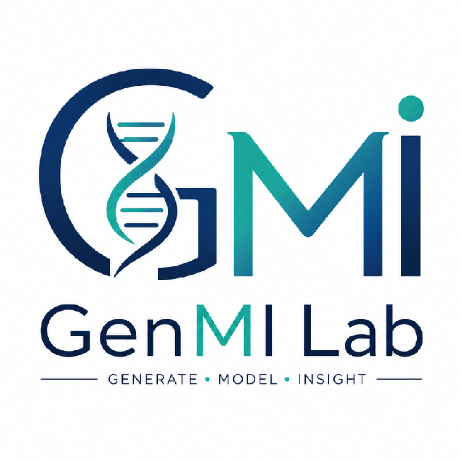
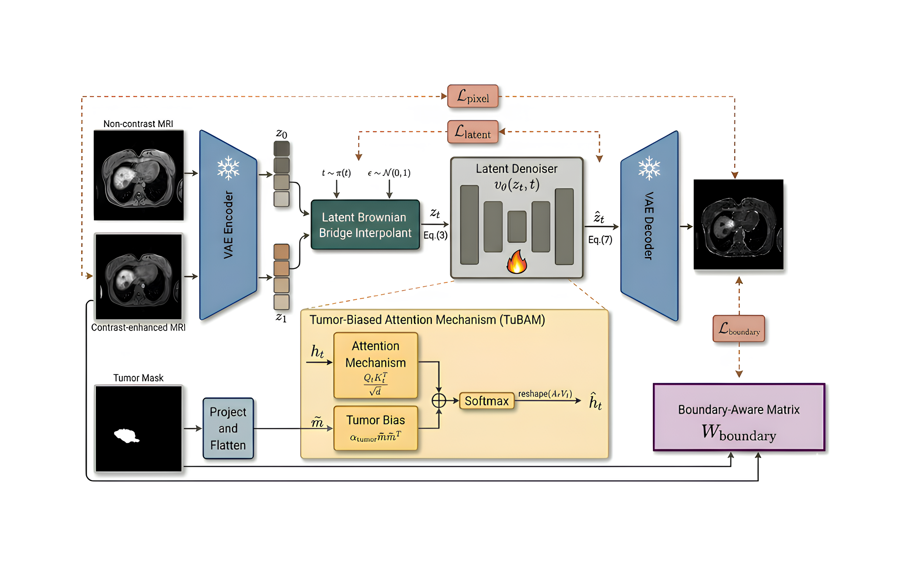
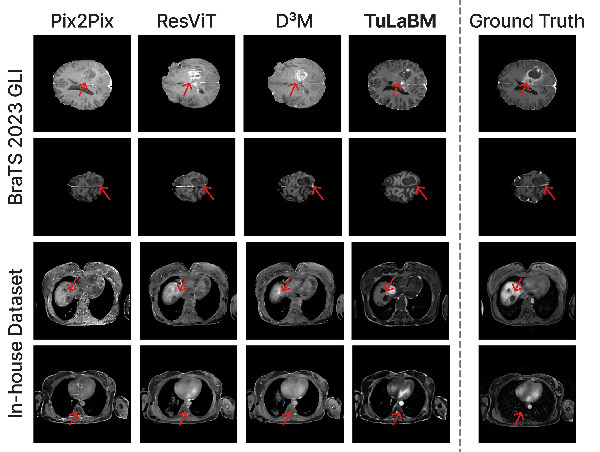

<h1 align="center">
<strong>TuLaBM: Tumor-Biased Latent Bridge Matching for Contrast-Enhanced MRI Synthesis</strong>
</h1>

<div align="center">

<a href="https://git.io/typing-svg">

</a>

[](#-citation)
[](#-pretrained-weights)
[](#-method)
[](#️-installation)
[](https://visitorbadge.io/status?path=https%3A%2F%2Fgithub.com%2Fgenmilab%2FTuLaBM)

<h3>🧠 <a href="#-method">Method</a> &nbsp;|&nbsp; 🏆 <a href="#-results">Results</a> &nbsp;|&nbsp; 🧩 <a href="#-pretrained-weights">Weights</a> &nbsp;|&nbsp; 🏋️ <a href="#️-training">Train</a> &nbsp;|&nbsp; ⚡ <a href="#-inference-and-evaluation">Evaluate</a></h3>



</div>

## 🔥 News
- **[Nov 2026]** 🚀 Training, inference and evaluation code for BraTS 2023 GLI is released.
- 📄 The paper is submitted to **IEEE ISBI 2027**.

## Overview
Reference implementation of **TuLaBM**, which synthesizes contrast-enhanced MRI (CE-MRI) from non-contrast MRI (NC-MRI) to reduce the need for gadolinium-based contrast agents.

TuLaBM casts NC-to-CE translation as **Brownian bridge transport** between the two image distributions in the latent space of a frozen, pretrained autoencoder, so sampling starts from the NC image rather than from noise and takes only a few steps. Two tumor-specific components act **during training only**: a **Tumor-Biased Attention Mechanism (TuBAM)** that adds a tumor-mask bias to the self-attention logits of the drift network, and a **boundary-aware loss** that weights reconstruction errors at tumor margins. **At inference only the NC image is needed: no tumor mask and no CE image.**

<p align="center">

<br/>
<em><b>Fig. 1. Overview of TuLaBM.</b> A frozen VAE encodes the NC and CE images into latents z<sub>0</sub> and z<sub>1</sub>. The latent denoiser v<sub>θ</sub> predicts the bridge drift at the interpolant z<sub>t</sub>, from which the terminal latent ẑ<sub>1</sub> is obtained and decoded. During training, TuBAM adds the tumor bias α·m̃m̃<sup>⊤</sup> to the self-attention logits, and the latent, pixel and boundary-weighted losses supervise the model. Inference requires only the NC image.</em>
</p>

## 📖 Contents
- [🧠 Method](#-method)
- [🏆 Results](#-results)
- [🔍 Qualitative Results](#-qualitative-results)
- [⛏️ Installation](#️-installation)
- [🗃️ Data](#️-data)
- [🧩 Pretrained Weights](#-pretrained-weights)
- [🏋️ Training](#️-training)
- [⚡ Inference and Evaluation](#-inference-and-evaluation)
- [🗂️ Repository Structure](#️-repository-structure)
- [⚠️ Limitations](#️-limitations)
- [📝 Citation](#-citation)
- [📚 Acknowledgments](#-acknowledgments)
- [📨 Contact](#-contact)

## 🧠 Method

### Latent bridge matching

An NC slice `x0` and its paired CE slice `x1` are encoded by the frozen SDXL VAE into `z0 = E(x0)` and `z1 = E(x1)`. The drift network `v_θ` (the SDXL U-Net) is trained on the Brownian bridge interpolant

```
z_t   = (1 - t) * z0 + t * z1 + σ * sqrt(t (1 - t)) * ε,      ε ~ N(0, I)
L_lat = || (z1 - z_t) / (1 - t) - v_θ(z_t, t) ||²
ẑ1    = z_t + (1 - t) * v_θ(z_t, t),      x̂1 = D(ẑ1)
```

and the decoded prediction is supervised in image space by `L_pix = |x̂1 - x1|₁`.

### Tumor-specific components

| Component | What it does | Where |
|---|---|---|
| **TuBAM** | Adds `α · m mᵀ` to the self-attention logits, where `m` is the tumor mask resampled to each attention resolution by nearest-neighbour interpolation. For a tumor query this multiplies the weights of tumor keys by `e^α` (≈ 1.65 for α = 0.5) before renormalization. No parameters are added; it is **disabled in eval mode**. | `src/lbm/models/attention/tumor_attention.py` |
| **Boundary-aware loss** | Weights the L1 error by `w = exp(-D / τ) · m`, where `D` is the distance to the tumor boundary clipped at `d_max = 30` px and normalized to [0, 1]. Weights peak at the margin, decay toward the core and are zero outside the tumor; normalizing by `Σ w` makes the loss independent of tumor size. | `src/lbm/models/lbm/lbm_model.py` |

The full objective is `L = L_lat + λ_pix · L_pix + λ_boundary · L_boundary`.

### Inference

The NC latent initializes the bridge at `t = 0`, and the SDE is integrated with the learned drift in `K` Euler–Maruyama steps on a uniform grid (`K = 4` in the paper), then decoded. Attention is standard and no tumor mask is used.

> [!NOTE]
> Because TuBAM and the boundary-aware loss act only during training, the deployed model has the same architecture, cost and inputs as a plain latent bridge model.

## 🏆 Results

Whole-image and tumor-region PSNR (dB) and SSIM (%) on BraTS 2023 GLI (T1n → T1c), mean ± standard deviation over test slices, with inference time per slice:

<div align="center">

| Method | PSNR ↑ | SSIM ↑ | Tumor PSNR ↑ | Tumor SSIM ↑ | Time (s) ↓ |
|---|:---:|:---:|:---:|:---:|:---:|
| Pix2Pix | 23.53 ± 2.89 | 87.70 ± 4.25 | 15.31 ± 4.40 | 65.37 ± 18.38 | **0.024** |
| ResViT | 23.54 ± 2.81 | 87.43 ± 4.19 | 15.21 ± 4.41 | 65.19 ± 17.87 | 0.028 |
| Palette | 18.95 ± 5.02 | 39.97 ± 29.09 | 14.00 ± 4.75 | 67.86 ± 17.10 | 1.22 |
| I²SB | 25.01 ± 2.94 | 89.11 ± 3.99 | 17.05 ± 4.81 | 71.59 ± 16.66 | 11.8 |
| D³M | 25.11 ± 3.33 | 90.95 ± 3.86 | 17.33 ± 4.56 | 73.21 ± 16.22 | 4.58 |
| **TuLaBM** | **25.16 ± 2.58** | **92.40 ± 1.51** | **18.34 ± 3.01** | **88.66 ± 5.78** | 0.097 |

</div>

- The largest gain is in the tumor region: SSIM rises from 73.21% to 88.66%, with a standard deviation about three times smaller than that of every baseline.
- Whole-image PSNR is on par with D³M (+0.05 dB).
- TuLaBM is 47–122× faster than the pixel-space models D³M and I²SB, and about 4× slower than the single-pass GANs.

<details>
<summary><strong>In-house liver MRI (zero-shot and fine-tuned)</strong></summary>

<div align="center">

| Method | Zero-shot PSNR ↑ | Zero-shot SSIM ↑ | Fine-tuned PSNR ↑ | Fine-tuned SSIM ↑ |
|---|:---:|:---:|:---:|:---:|
| Pix2Pix | 16.46 ± 0.93 | 48.84 ± 0.08 | 18.65 ± 0.39 | 50.62 ± 0.06 |
| ResViT | 16.21 ± 1.67 | 53.73 ± 0.10 | 18.28 ± 0.95 | 56.15 ± 0.07 |
| Palette | 15.11 ± 1.90 | 45.03 ± 2.18 | 17.21 ± 0.29 | 52.13 ± 0.06 |
| I²SB | 16.47 ± 1.70 | 50.14 ± 0.40 | 18.70 ± 1.29 | 56.17 ± 0.01 |
| D³M | 16.50 ± 3.45 | 57.13 ± 1.02 | 18.73 ± 1.40 | 58.19 ± 0.03 |
| **TuLaBM** | **16.57 ± 0.55** | **58.30 ± 9.17** | **19.34 ± 1.53** | **63.60 ± 9.45** |

</div>

The BraTS-trained model is applied directly (zero-shot) and after fine-tuning on five liver volumes. The liver data are not released.

</details>

<details>
<summary><strong>Ablation on BraTS 2023 GLI</strong></summary>

<div align="center">

| Variant | PSNR ↑ | SSIM ↑ | Tumor PSNR ↑ | Tumor SSIM ↑ |
|---|:---:|:---:|:---:|:---:|
| **TuLaBM** | **25.16 ± 2.58** | **92.40 ± 1.51** | **18.34 ± 3.01** | **88.66 ± 5.78** |
| w/o boundary loss | 22.53 ± 2.46 | 88.13 ± 1.35 | 16.34 ± 3.22 | 84.17 ± 7.20 |
| w/o boundary loss, TuBAM | 22.19 ± 2.44 | 88.09 | 16.38 ± 3.18 | 84.16 ± 7.13 |

</div>

The boundary-aware loss drives most of the gain. TuBAM's contribution is small: it lowers whole-image PSNR from 22.53 to 22.19 dB when removed, while the tumor-region metrics barely change.

</details>

## 🔍 Qualitative Results

<p align="center">

<br/>
<em><b>Qualitative comparison</b> of synthesized CE-MRI on BraTS 2023 GLI (rows 1–2) and in-house liver MRI (rows 3–4). Arrows mark enhancing tumor and vessels.</em>
</p>

TuLaBM reproduces the enhancing tumor rim and its margins more faithfully than the baselines. Pix2Pix and ResViT produce false-positive enhancement, and D³M delineates tumor boundaries less precisely.

## ⛏️ Installation

```bash
git clone https://github.com/genmilab/TuLaBM.git
cd TuLaBM
conda create -n tulabm python=3.10 -y
conda activate tulabm
pip install -e .
```

Requirements: Python ≥ 3.10, PyTorch 2.7, `diffusers` 0.32, Lightning 2.5, NiBabel, SciPy and scikit-image (full list in `requirements.txt`). The SDXL VAE and U-Net are downloaded from `stabilityai/stable-diffusion-xl-base-1.0` on first use.

## 🗃️ Data

Download the **BraTS 2023 GLI** training and validation releases from [Synapse](https://www.synapse.org/Synapse:syn51156910/wiki/621282) into `data/`:

```text
data/
├── ASNR-MICCAI-BraTS2023-GLI-Challenge-TrainingData/
└── ASNR-MICCAI-BraTS2023-GLI-Challenge-ValidationData/
```

Then build the slice shards:

```bash
python scripts/construct_dataset.py
```

This clips each volume to its 0.1th–99.9th intensity percentiles, rescales to [0, 1], zero-pads axial slices to 256 × 256 and writes, per slice, the T1n source, T1c target, tumor mask (union of all labels) and boundary distance map as WebDataset shards in `data/BraTS2023_GLI_imgs/{train,validation,test}`. The training release is split 80/20 at the subject level (seed 42; 1,001 / 250 volumes), and the 219 volumes of the validation release form the test set. Training and validation slices with less than 3% foreground are discarded. The split is saved to `data/BraTS2023_GLI_splits.csv`.

## 🧩 Pretrained Weights

The BraTS 2023 GLI checkpoint will be released here.

| File | Dataset | Task | Latent | Steps | Download |
|---|---|---|---|---|---|
| `tulabm_brats2023_gli.ckpt` | BraTS 2023 GLI | T1n → T1c | 4 × 32 × 32 | 4 | coming soon |

## 🏋️ Training

```bash
python examples/training/train_tulabm.py examples/training/config/brats.yaml
```

Set `train_shards`, `validation_shards` and `save_ckpt_path` in `examples/training/config/brats.yaml` first. The configuration reported in the paper:

| Key | Value | Meaning |
|---|---|---|
| `selected_timesteps`, `prob` | [250, 500, 750, 1000], uniform | training timesteps t ∈ {0, ¼, ½, ¾} |
| `bridge_noise_sigma` | 0.008 | bridge noise σ |
| `attention_bias_weight` | 0.5 | TuBAM bias strength α |
| `boundary_tau` | 0.25 | boundary-loss temperature τ |
| `latent_loss_weight` | 1.0 | weight of L_lat (L2) |
| `pixel_loss_weight` | 18.0 | λ_pix (L1) |
| `boundary_loss_weight` | 14.0 | λ_boundary |
| `learning_rate`, `optimizer` | 4e-5, AdamW | optimizer |
| `batch_size`, `max_steps` | 8, 50,000 | about 10 h on one NVIDIA A100 (bf16) |

Checkpoints are written to `save_ckpt_path` every `save_interval` steps, and runs are logged to Weights & Biases (`wandb_project`).

## ⚡ Inference and Evaluation

Extract the test slices, run inference, then score the predictions:

```bash
python scripts/construct_test_dataset.py   # -> data/BraTS2023_GLI_test/{source,target,mask}

python examples/inference/inference_tulabm.py \
    --config examples/inference/config/brats.yaml \
    --ckpt_path /path/to/BraTS2023_GLI_ckpts/last.ckpt \
    --source_dir data/BraTS2023_GLI_test/source \
    --target_dir data/BraTS2023_GLI_test/target \
    --mask_dir data/BraTS2023_GLI_test/mask \
    --final_dir results/brats \
    --num_inference_steps 4

python scripts/evaluate.py \
    --pred_dir results/brats/output \
    --target_dir results/brats/target \
    --mask_dir results/brats/mask \
    --out_csv results/brats/metrics.csv
```

Only `--source_dir` is needed to synthesize; `--target_dir` and `--mask_dir` copy the references next to the predictions for evaluation. `evaluate.py` reports whole-image and tumor-region PSNR and SSIM (Gaussian window, σ = 1.5) as mean ± std over slices. Tumor-region SSIM is the mean of the SSIM map inside the mask, and tumor-region metrics use only slices that contain tumor.

## 🗂️ Repository Structure

```text
TuLaBM/
├── src/lbm/
│   ├── models/
│   │   ├── attention/    # TumorBiasedAttention (TuBAM)
│   │   ├── lbm/          # latent bridge model, boundary-aware loss, sampling
│   │   ├── unets/        # SDXL U-Net wrapper with TuBAM in self-attention
│   │   ├── vae/          # frozen AutoencoderKL wrapper
│   │   └── embedders/    # conditioning wrappers
│   ├── data/             # WebDataset loading, filters and mappers
│   ├── trainer/          # Lightning training pipeline and loggers
│   └── inference/        # checkpoint loading and sampling
├── examples/
│   ├── training/         # train_tulabm.py + config/brats.yaml
│   └── inference/        # inference_tulabm.py + config/brats.yaml
├── scripts/
│   ├── construct_dataset.py       # BraTS preprocessing and sharding
│   ├── construct_test_dataset.py  # test shards -> source/target/mask folders
│   └── evaluate.py                # whole-image and tumor-region PSNR/SSIM
├── tests/                # pytest unit tests (python -m pytest tests)
├── docs/assets/          # README figures
└── requirements.txt
```

## ⚠️ Limitations

- The model is 2D and maps a single NC sequence (T1n) to T1c, without T2-weighted or FLAIR inputs or through-plane context.
- Training requires tumor annotations, and the frozen VAE, pretrained on natural images, bounds the attainable reconstruction quality.
- Zero-shot liver results remain far below in-domain performance; a new anatomy still needs target-domain data.
- PSNR and SSIM do not establish diagnostic equivalence. A reader study and downstream segmentation on synthesized images are still needed.

## 📝 Citation

The citation will be added once the review process concludes.

## 📚 Acknowledgments

This code builds on [LBM: Latent Bridge Matching](https://github.com/gojasper/LBM) (Chadebec et al., 2025) and uses the SDXL VAE and U-Net. The baselines are Pix2Pix, ResViT, Palette, I²SB and D³M. We thank the organizers of the BraTS 2023 challenge, and acknowledge the support of Mohamed bin Zayed University of Artificial Intelligence (MBZUAI) and Cleveland Clinic Abu Dhabi.

The code is released under the [CC BY-NC 4.0](LICENSE) license.

## 📨 Contact
For questions, please open an [issue](https://github.com/genmilab/TuLaBM/issues).

> [!IMPORTANT]
> TuLaBM is intended for research only. It is not validated for clinical use and must not inform any diagnostic or treatment decision.
